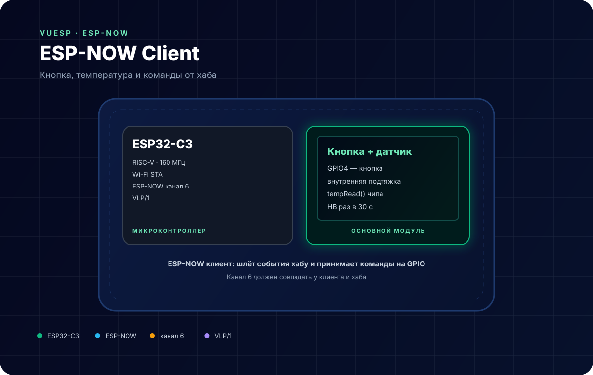
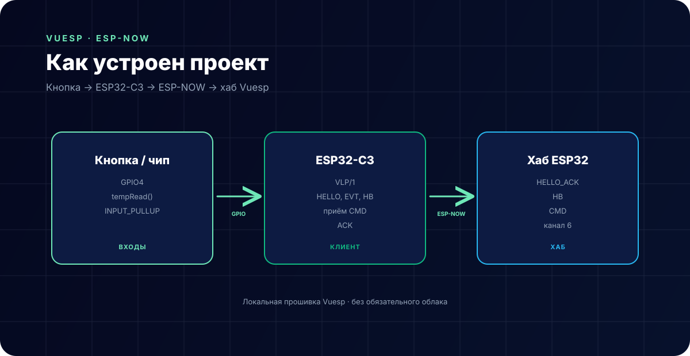

# ESP-NOW Client — кнопка и температура



**Коротко:** `vuesp.espnow-client` — прошивка ESP32-C3, которая отправляет события кнопки и температуру по **ESP-NOW** на хаб `vuesp.espnow-hub`, принимает команды на GPIO и подтверждает их. Работает по текстовому протоколу **VLP/1** без Wi-Fi-роутера.

## Что это за устройство

Клиент — это автономный узел ESP-NOW:

- при старте рассылает `HELLO` и ждёт `HELLO_ACK` от хаба;
- при нажатии кнопки отправляет `EVT k=btn`;
- раз в 30 секунд отправляет температуру `EVT k=temp`;
- раз в 30 секунд отправляет `HB` (heartbeat);
- принимает `CMD` и подтверждает их `ACK`;
- выполняет команды `relay`, `led`, `output` для указанного GPIO.

Клиент не требует роутера: ESP-NOW работает напрямую между ESP32.

## Характеристики

| Параметр | Значение |
| --- | --- |
| Микроконтроллер | ESP32-C3 (RISC-V, 160 МГц) |
| Радио | Wi-Fi 2.4 ГГц, режим STA |
| Протокол | ESP-NOW, канал 6 |
| Формат данных | текст VLP/1 |
| Кнопка | GPIO4, `INPUT_PULLUP` |
| Температура | внутренний датчик чипа `temperatureRead()` |
| Период HELLO | 5 с, пока хаб не найден |
| Период HB | 30 с |
| Среда | PlatformIO + Arduino |

## Распиновка

| Сигнал | GPIO | Примечание |
| --- | --- | --- |
| Кнопка | 4 | между GPIO4 и GND, внутренняя подтяжка |
| Команды `relay`/`led`/`output` | любой из `CMD` | `pinMode(OUTPUT)` по команде |

Свободные GPIO можно использовать для реле, светодиода или выхода. Клиент не хранит список пинов: он выполняет команду для того GPIO, который указал хаб.

## Схема подключения

```text
Кнопка:  GPIO4 ── кнопка ── GND
Питание: 5 В / 3.3 В на плату ESP32-C3
```

- Кнопка замыкает GPIO4 на GND; используется внутренняя подтяжка.
- Для реле добавьте транзистор/оптопару и внешнее питание — GPIO не тянет катушку.
- Антенна ESP32-C3 должна быть свободна от металла.

## Протокол VLP/1

Кадры — обычный текст, отправляемый через ESP-NOW:

| Тип | Кто отправляет | Назначение |
| --- | --- | --- |
| `HELLO` | клиент | представить себя, сообщить канал и возможности |
| `HELLO_ACK` | хаб | подтвердить и запомнить клиента |
| `HB` | обе стороны | heartbeat |
| `EVT` | клиент | событие: `k=btn`, `k=temp` |
| `CMD` | хаб | команда: `action`, `gpio`, `value` |
| `ACK` | клиент | подтверждение команды |

Клиент запоминает MAC хаба из `HELLO_ACK` или `HB`. Пока хаб не найден, `HELLO` рассылается каждые 5 секунд, а события складываются в `pendingEvent`.

## Настройка

В `src/espnow/espnow.cpp`:

```cpp
#define ESPNOW_CHANNEL 6
#define CLIENT_BUTTON_GPIO 4
```

Канал должен совпадать с хабом и всеми клиентами. Клиент работает в режиме `WIFI_STA` и переключает канал через `esp_wifi_set_channel()`.

## Как устроен проект



- `src/espnow/espnow.cpp` — инициализация ESP-NOW, HELLO/HB/EVT, приём CMD;
- `src/espnow/vlp.h` — сборка и разбор кадров VLP/1;
- `src/device/device.cpp` — стандартное устройство Vuesp и `http`-функция;
- `vue/` — локальный веб-интерфейс (не обязателен для работы ESP-NOW).

Логика:

```text
кнопка/температура → VLP EVT → ESP-NOW → хаб
хаб → VLP CMD → ESP-NOW → GPIO + ACK
```

## ScriptRunner

| Функция | Назначение |
| --- | --- |
| `http(method, url, count, num, data)` | заготовка HTTP-запроса |
| `$display` | строковый буфер для сценариев |

Пример:

```text
log('espnow client ready');
```

## Сборка и прошивка

```bash
cd vue
npm ci
npm run build-web

cd ..
~/.platformio/penv/bin/pio run -e esp32-c3-devkitm-1
~/.platformio/penv/bin/pio run -e esp32-c3-devkitm-1 -t upload
~/.platformio/penv/bin/pio device monitor -b 115200
```

## Ограничения

- ESP-NOW без шифрования: любой ESP32 в радиусе может отправить кадр.
- Канал 6 должен совпадать у клиента, хаба и (если есть) точки доступа.
- MAC хаба не сохраняется во flash: после перезагрузки клиент снова ищет хаб через `HELLO`.
- `temperatureRead()` — температура кристалла ESP32-C3, а не температура воздуха. Для реального датчика нужен DS18B20/DHT.
- Кнопка опрашивается каждые 20 мс, а не по прерыванию: очень короткое нажатие может быть пропущено.
- Команды выполняются для произвольного GPIO из кадра — доверяйте только своему хабу.
- Локальный веб-интерфейс дублирует шаблон Vuesp и не управляет ESP-NOW.

## Источники

- [ESP-NOW — документация Espressif](https://docs.espressif.com/projects/esp-idf/en/latest/esp32/api-reference/network/esp_now.html)
- [ESP32-C3 datasheet](https://www.espressif.com/sites/default/files/documentation/esp32-c3_datasheet_en.pdf)
- [Документация Vuesp](https://docs.vuesp.ru)
